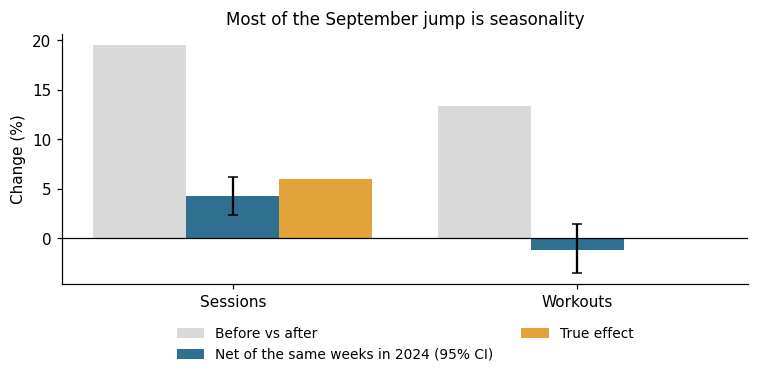
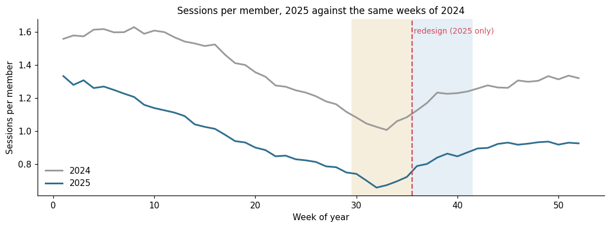
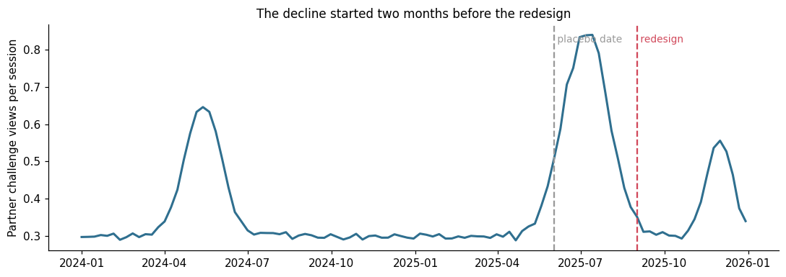
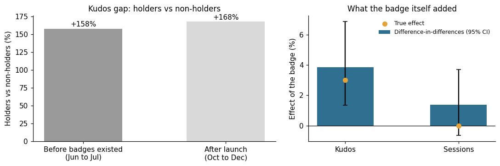
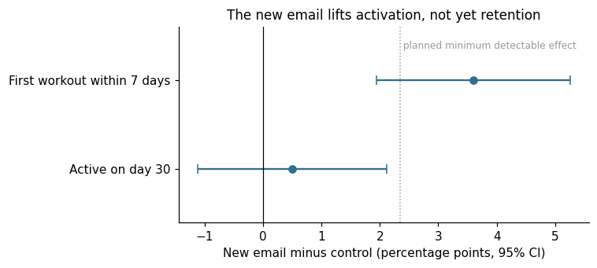

# Did the launch work? Three product readouts with placebo checks

Three common launch questions, each with its own trap: seasonality, a confounding campaign cycle, selection bias, and a real A/B test done properly. Built as a dbt project on DuckDB, with data tests.

> **Everything in this repository is synthetic.** The app, the launches, the members and every number are invented and generated by `data/generate.py`. The true effects are planted in the generator, so the README can show which method recovers them.



## The setting

A workout tracking app with a social feed shipped three things in the second half of 2025:

| Launch | Date | The question |
|---|---|---|
| Redesigned home feed | 2025-09-01 | Did it increase sessions and workouts? Did it hurt sponsored content? |
| "Century" badge for 100 logged workouts | 2025-10-06 | Does the badge make members more social? |
| New onboarding email, 50/50 A/B test | Sep to Nov 2025 signups | Should it replace the current email? |

## 1. Home feed redesign: seasonality and a campaign cycle

**The dashboard said:** sessions up 19.5% and workouts up 13.4% after launch. Partner challenge views per session down 44%, so the redesign "hurt sponsored content".

**The trap:** September is when people get back to their routine. The same six weeks one year earlier, with no launch, already show sessions up 14.6% and workouts up 14.7%.



**Approach:** for a fixed cohort of members (joined before every window opens, so the population never changes), compare 6 weeks before and 6 weeks after launch, then divide by the same change in the same calendar weeks of 2024:

```
adjusted = (after / before, 2025) / (after / before, 2024) - 1
```

Intervals come from 500 bootstrap resamples of members. A placebo date (2025-06-02, when nothing launched) runs through the exact same models.

| Metric | Before vs after | Same weeks in 2024 | Adjusted (95% CI) | Placebo date | True effect |
|---|---|---|---|---|---|
| Sessions per member | +19.5% | +14.6% | **+4.3%** (+2.4% to +6.2%) | +0.5% | +6% |
| Workouts per member | +13.4% | +14.7% | **-1.1%** (-3.5% to +1.5%) | +1.0% | 0% |
| Partner views per session | -44.2% | -1.3% | -43.5% | **+219.7%** | 0% |

For sessions and workouts the placebo finds nothing, which is what lets you trust the adjusted number. For partner views it finds a +220% "effect" on a date when nothing happened. That is the signal that the method does not work for this metric.



**Why:** sponsored content runs in campaigns, and campaigns fall on different weeks every year. The 2025 campaign peaked in July and was winding down when the redesign shipped. A year-over-year comparison removes the calendar, not the campaign schedule. The weekly series answers the question: the decline started two months before launch.

**Readout:** the redesign added about 4% to 6% more sessions and did not change workouts. There is no evidence it changed sponsored content views: the drop follows the campaign calendar.

## 2. Century badge: selection, not effect

**The dashboard said:** after launch, badge holders give 168% more kudos than non-holders.

**The trap:** to get the badge you need 100 workouts, so holders are the most active members by definition. Before badges existed, the same people already gave 158% more kudos.



**Approach:** holders are members with the badge at the start of the "after" window; non-holders are everyone else. Status is fixed at that date and never updated with what happens later. Both groups joined before the "before" window and were active in the four weeks before launch, a check that sits outside both measurement windows so it does not filter on the outcome. Then the same relative difference-in-differences as above: how much more holders changed than non-holders, from Jun to Jul 2025 (no badges yet) to Oct to Dec 2025.

| Metric | Gap after launch | Gap before launch | Difference-in-differences (95% CI) | True effect |
|---|---|---|---|---|
| Kudos given | +168% | +158% | **+3.8%** (+1.3% to +6.9%) | +3% |
| Sessions | +125% | +122% | **+1.4%** (-0.7% to +3.7%) | 0% |

**One more check:** 90% of holders (4,861 of 5,386) got the badge through the backfill at launch, for workouts they had already logged. Only 525 earned it after launch. So far the badge mostly labels people who were already active, and it is too early to say whether it makes anyone work out more.

**Readout:** the badge adds a small lift in kudos, about 4%, not 168%. No measurable effect on sessions. Revisit once organic earners are a meaningful share of holders.

## 3. Onboarding email: an A/B test done properly

New signups from September to November 2025 were split 50/50 between the current onboarding email and a new one. The plan was fixed before launch: primary metric is a first workout within 7 days, secondary is being active on day 30.

**Checks before reading the result:**
- **Sample size:** about 6,000 members per arm at a 30% baseline gives 80% power to detect a 2.3 percentage point lift.
- **Sample ratio mismatch:** 5,970 control and 6,030 new email. A chi-square test against 50/50 gives p = 0.58, so the split worked.



| Metric | Control | New email | Difference (95% CI) | p-value | True effect |
|---|---|---|---|---|---|
| First workout within 7 days | 29.6% | 33.2% | **+3.6 pp** (+1.9 to +5.3) | < 0.001 | +3.5 pp |
| Active on day 30 | 28.3% | 28.8% | +0.5 pp (-1.1 to +2.1) | 0.55 | not planted |

**Readout:** ship the new email. It gets more people to a first workout, above the minimum effect the test was sized for. It does not move 30-day activity yet, so the next test should target what happens after the first workout.

## Why a dbt project

The study design lives in `dbt_project.yml` (`vars`): launch dates, window length, the one-year offset, the badge windows. Change a date and every model follows. The models are layered (`staging`, then one folder per readout) and `dbt build` runs the data tests before any result is used:

| Test | What it protects |
|---|---|
| `unique`, `not_null`, `relationships`, `accepted_values` | Keys, joins and categories in every staging model |
| `unique_combination` (custom generic test) | One row per member and week in the activity table |
| `assert_feed_windows_same_length` | Before and after windows cover the same number of days |
| `assert_badge_awarded_only_past_threshold` | Every badge belongs to a member who really reached 100 workouts |
| `assert_one_badge_group_per_member` | No member is counted in both groups |

```
models/
  sources.yml                 raw CSVs, read straight from data/raw
  staging/                    typed views over the raw data, with tests
  feed_launch/                scenarios, fixed cohort, member windows, estimates, weekly trend
  badges/                     groups, member periods, estimates, award mix
  email_test/                 counts and rates per variant
tests/                        singular data tests
macros/                       the custom generic test
run_analysis.py               runs dbt build, then bootstrap intervals and the A/B statistics
notebook.ipynb                the same analysis with the charts
```

## Limitations

- **One prior year is a thin seasonal baseline.** With more history, average several years or model the seasonal pattern directly.
- **The year-over-year adjustment assumes the calendar effect is the same every year.** It fails for anything scheduled differently each year, like the partner campaigns. The placebo test is the guard.
- **The fixed cohort ages.** Members leave over time, so the cohort is smaller in 2025 than in 2024. Because the estimate is relative and churn is steady, this cancels out here. In real data it is worth checking.
- **The badge groups differ a lot in activity.** Difference-in-differences only needs them to move in parallel, not to look alike, but a gap this large is a reason to also try matched groups.

## Run it

```bash
pip install -r requirements.txt
python data/generate.py      # synthetic data, about 20 MB in data/raw/
python run_analysis.py       # dbt build (models + tests), then intervals and the A/B statistics
```

`notebook.ipynb` runs the same steps and draws the charts. To browse the models and their lineage: `dbt docs generate --profiles-dir . && dbt docs serve --profiles-dir .`

## Stack

dbt (dbt-duckdb), SQL (DuckDB), Python (pandas, NumPy, matplotlib). Built with AI assistance (Claude Code); the study design, the checks and the conclusions are mine.
